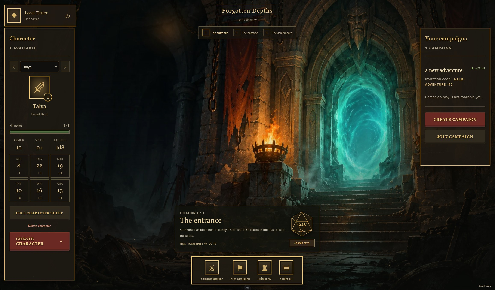

# Adventure Oracle

A fifth-edition tabletop companion built with Nuxt 4 and Vue 3. It currently
supports accounts, campaign creation and joining, character creation, and an
Open5e-backed rules reference stored in SQLite.

The intended experience combines personal player screens on phones or laptops
with a synchronized shared map and story display on a laptop or TV. This,
API-powered narration, story progression and occasional image generation are
planned. See [ROADMAP.md](ROADMAP.md).



## Run locally

Use Node.js 22.18.0 (see `.nvmrc`).

```sh
npm ci
```

Start the app:

```sh
npm run dev
```

`npm run dev` and `npm start` automatically create `.env` with a random local auth secret, initialize the SQLite database, and seed bundled SRD 5.1 rules. Existing configuration and data are preserved. No manual setup or internet connection is needed after dependencies are installed. You can also run this setup explicitly with `npm run setup:local`.

Database migrations and local accounts run offline using the installed dependencies and SQLite; Better Auth does not require a hosted service. The repository includes a pinned SRD 5.1 rules snapshot, so the rules reference works on first startup offline. Setup seeds empty rules categories and preserves populated categories, accounts, and campaigns.

Dependency installation needs internet access or a sufficient local npm cache. Maintainers can explicitly run `npm run open5e:update-snapshot` online to rebuild the bundled snapshot from its pinned upstream revision. Review the data and attribution changes before committing an update. `npm run open5e:seed` applies the bundle to empty rules categories after database migration. See [snapshot documentation](data/open5e/README.md). The legacy `npm run open5e:init` command downloads missing categories from the allowed SRD 5.1/A5E sources; startup never invokes it.
Non-production setup also creates `local@test.com` with password `testingtesting` through Better Auth. Existing accounts are preserved. Production never seeds this account; password requirements remain unchanged. No campaigns are bundled.
Local databases and environment files are ignored by Git.

## Checks and build

```sh
npm run typecheck
npm run lint
npm run test:offline
npm run build
npm run preview
```

## License

Original application code is licensed under [MIT](LICENSE). Imported game data
and dependencies retain their own terms; see [third-party notices](THIRD_PARTY_NOTICES.md).
Adventure Oracle is an independent project, unaffiliated with Wizards of the Coast.
